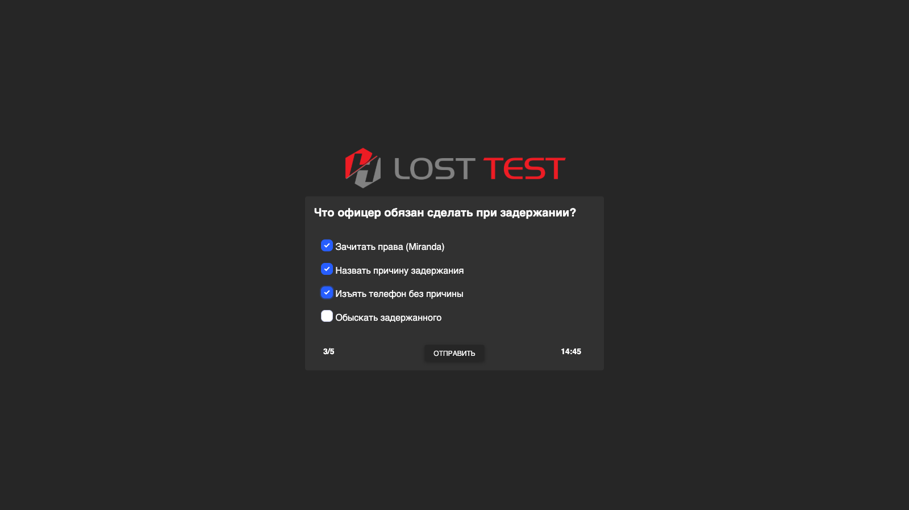
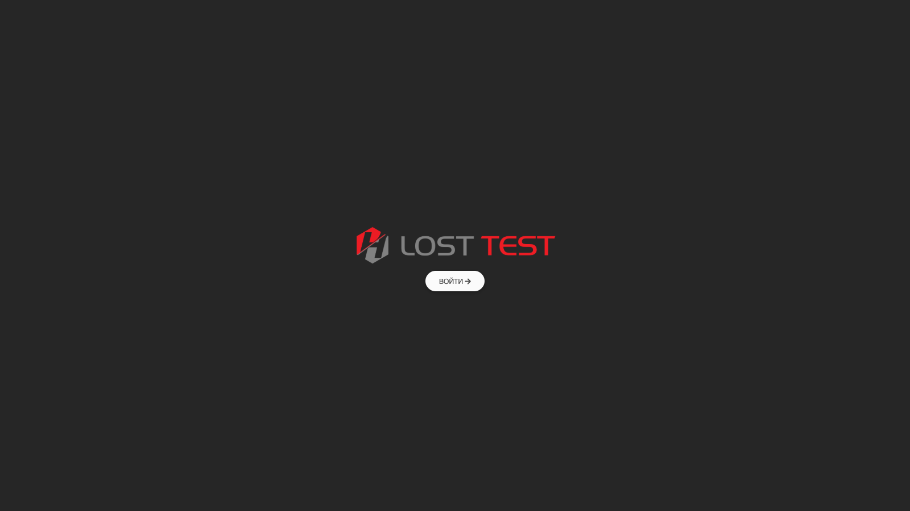
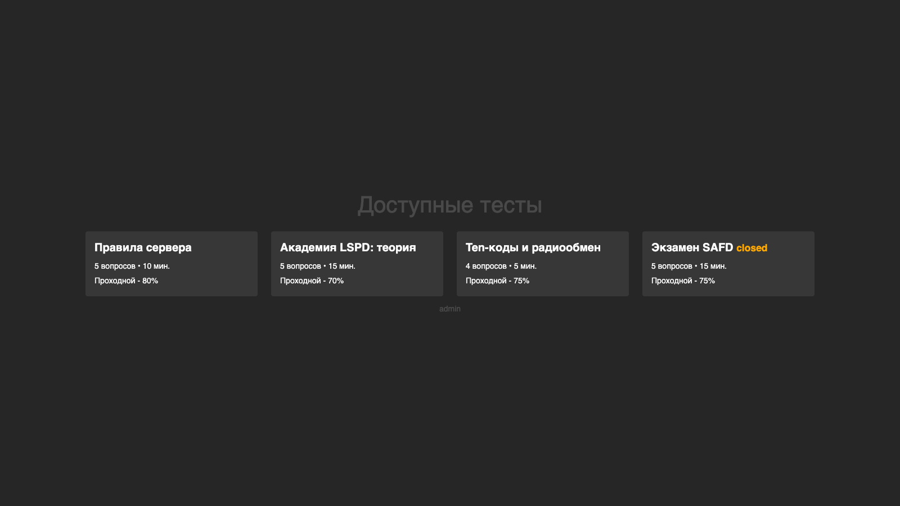
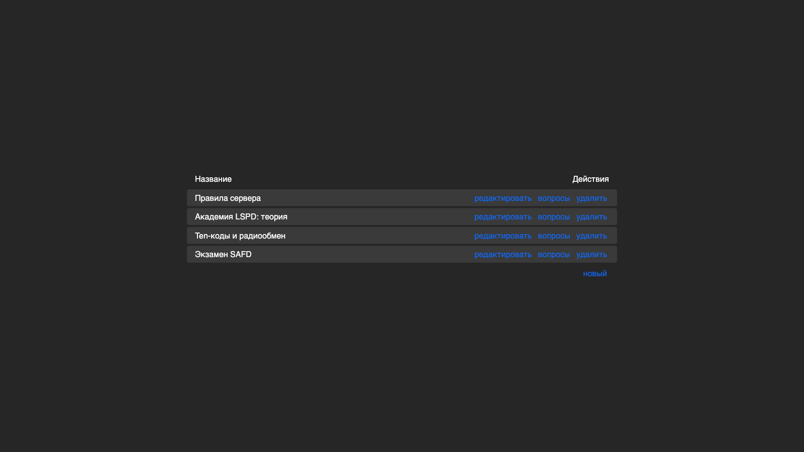
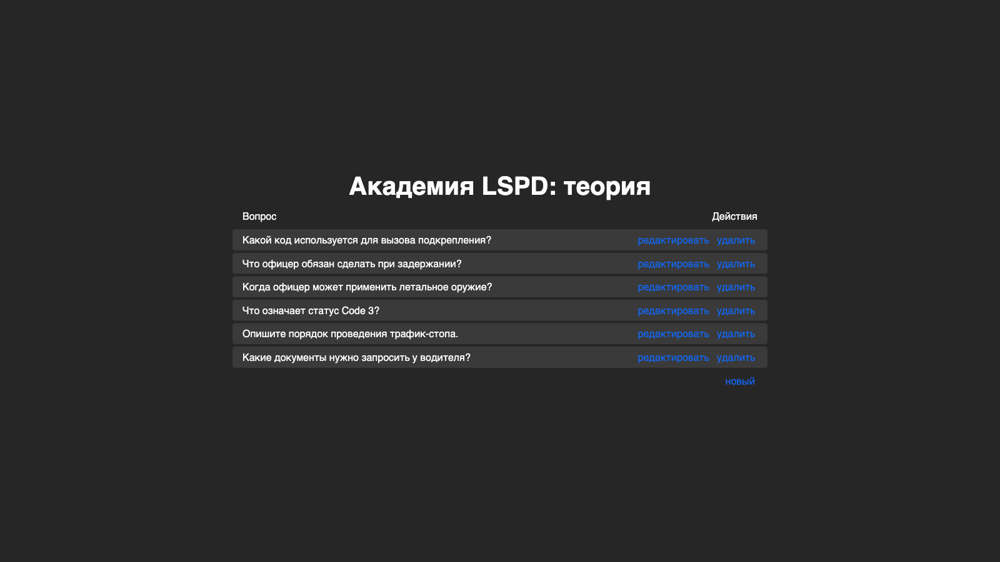
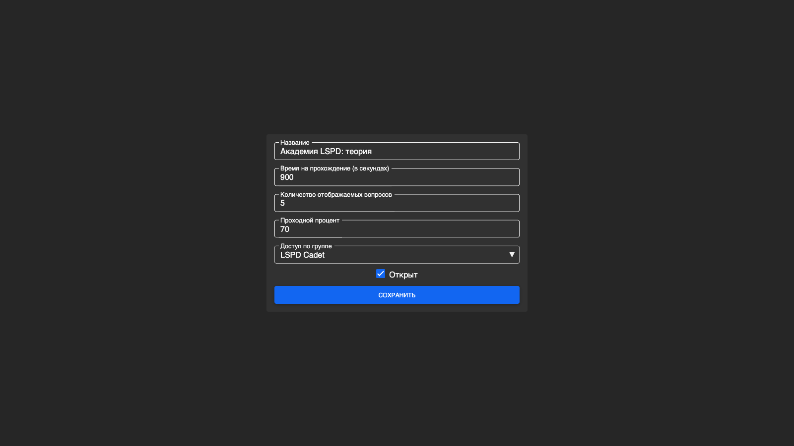
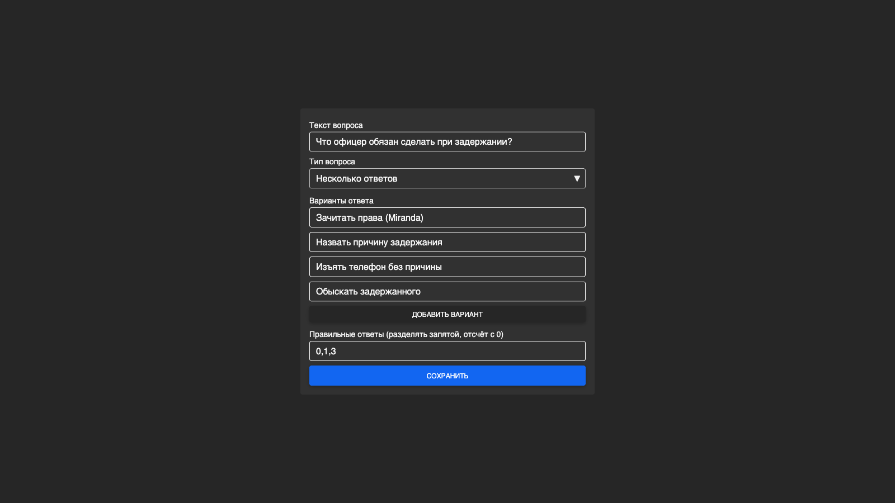
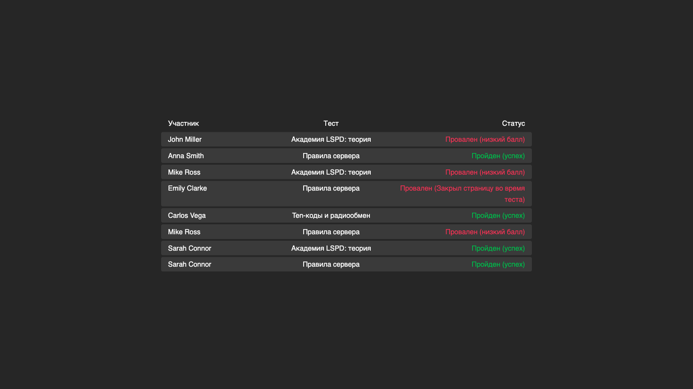
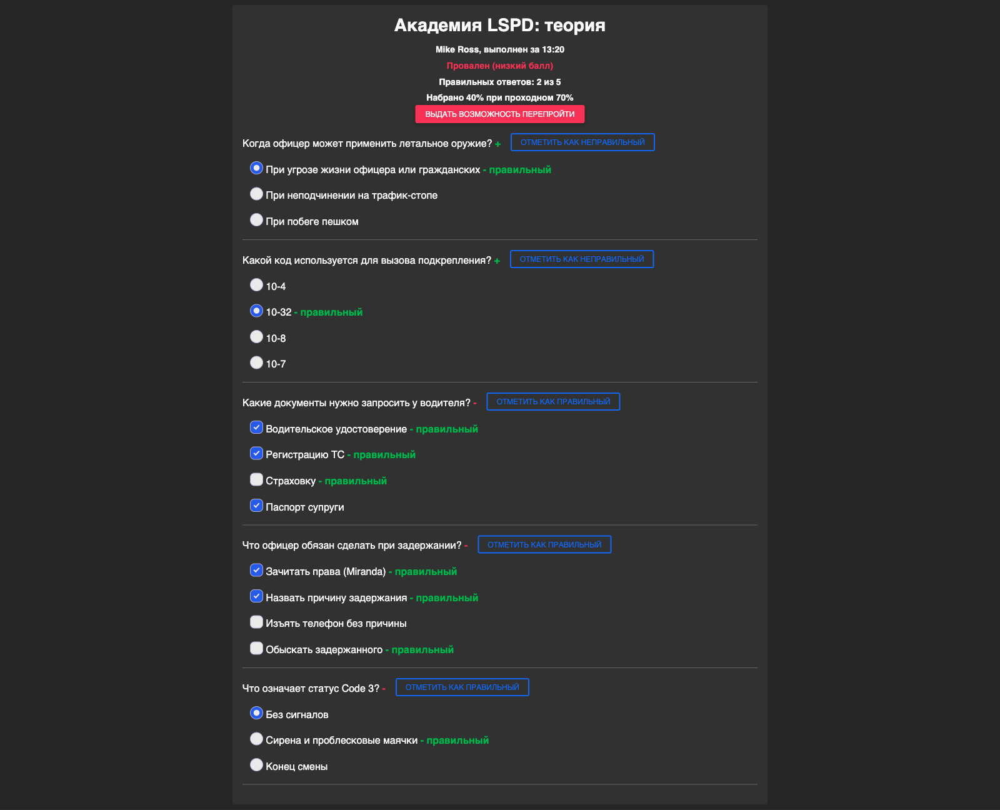

# Alderney

An online testing system for a gaming community: entrance tests, faction exams and rules checks. Users sign in with their forum account, access to tests depends on forum groups, answers can be reviewed by hand, and results are posted to Discord. Built in 2021 for the Lost project. The interface is in Russian.



## Screenshots

### Participant

| | |
|---|---|
|  Forum login |  Available tests |

### Admin

| | |
|---|---|
|  Test list |  Test questions |
|  Test settings |  Question editor |
|  Participant results |  Answer review with manual grading |

## Features

- **Tests**: time limit, a random subset of questions, pass percentage, access by forum group, opening and closing a test.
- **Question types**: single choice, multiple choice, free text.
- **Attempt control**: a server-side timer and keepalive requests. If a participant closes the page during a test, the attempt ends and is scored immediately.
- **Review**: a list of attempts, a breakdown of every answer, manually marking an answer as correct (for free-text questions), and granting a retake.
- **Roles**: admins edit tests and questions, trainers review results. Roles and access come from IPS4 forum groups.
- **Discord**: webhook notifications when a test is passed, failed or the page is closed.

## Stack

PHP 7.4, [FastRoute](https://github.com/nikic/FastRoute), [Twig](https://twig.symfony.com/), [RedBeanPHP](https://redbeanphp.com/), [Rakit Validation](https://github.com/rakit/validation), MySQL, jQuery, axios, MDBootstrap, Laravel Mix.

## Structure

```
database.sql           database schema
public/                document root: index.php with the routes, built assets in dist/
core/
  config.php           settings (databases, site URL, Discord webhook)
  controllers/         pages and API: tests, taking a test, admin
  facades/             forum authentication, test logic, Discord
  views/               Twig templates
assets/                style and JS sources (built into public/dist)
```

## Running

1. Create a database and import `database.sql`. Login needs the IPS4 forum database: the app reads the `core_members`, `core_members_known_devices`, `core_groups` and `core_sys_lang_words` tables.
2. Fill in `core/config.php`: credentials for both databases, `base_link` (the full site URL), admin and trainer groups, and the Discord webhook (can be left empty).
3. Install dependencies and build the frontend. This needs Node.js 18+ and Yarn specifically, because the webpack version is pinned with `resolutions`:
   ```
   composer install
   yarn install
   yarn production
   ```
4. Serve `public/` with Apache and `mod_rewrite` at `/alderney`. `RewriteBase` in `public/.htaccess` must match that path.
